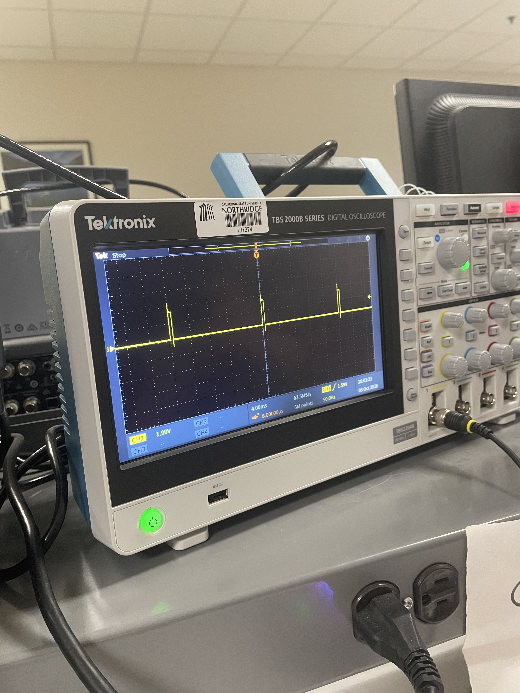
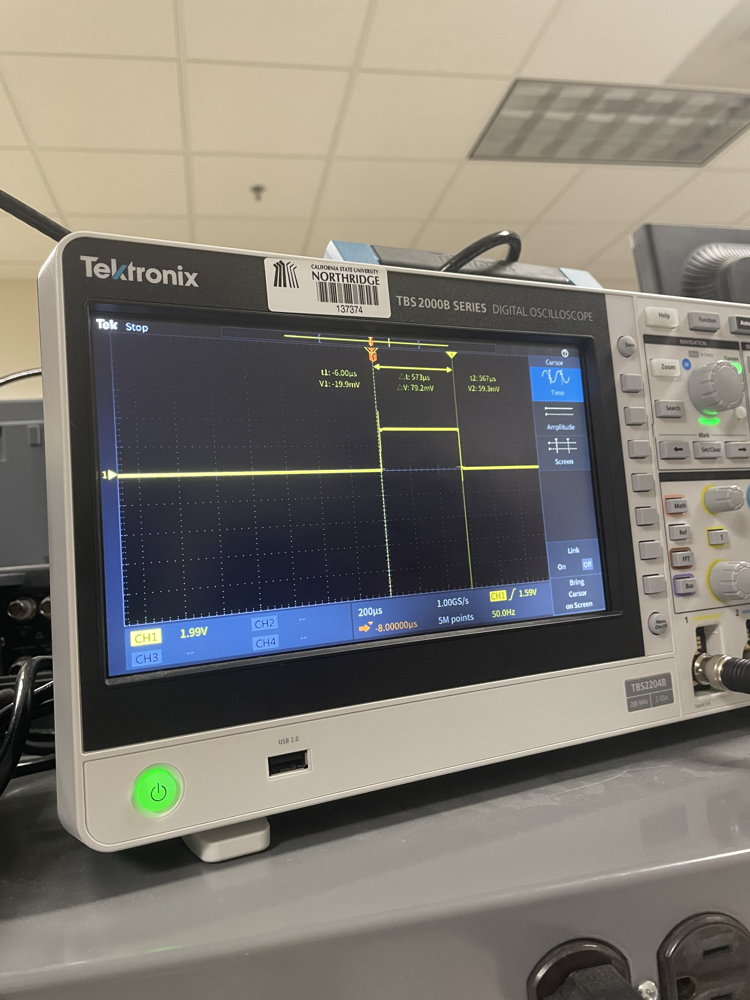
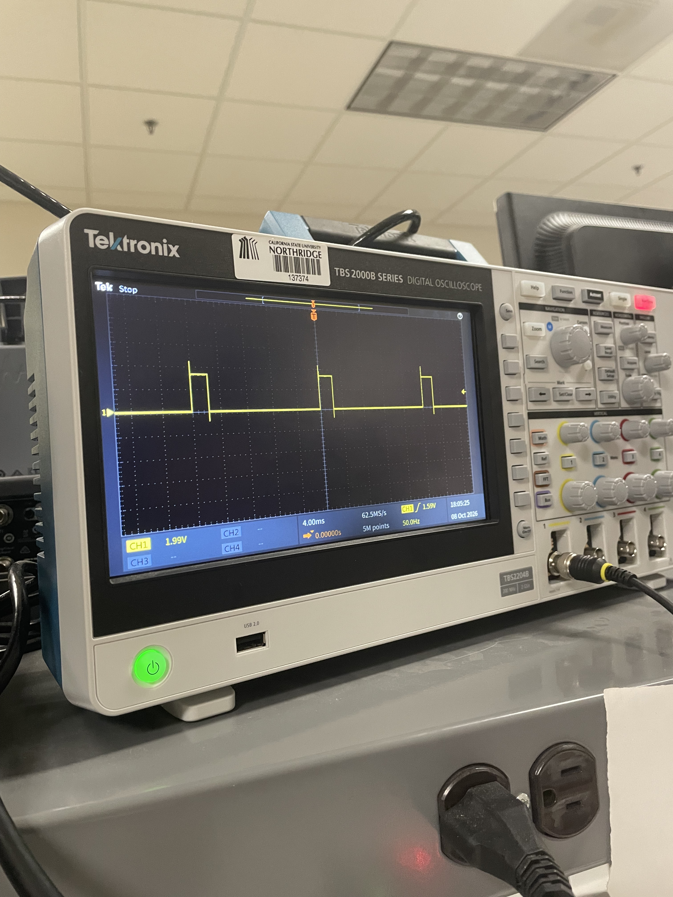
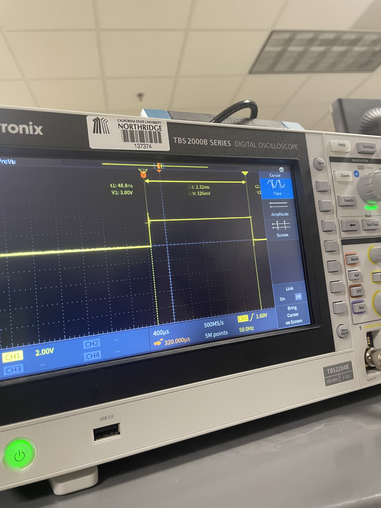
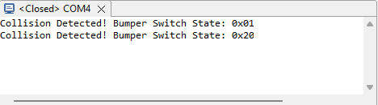
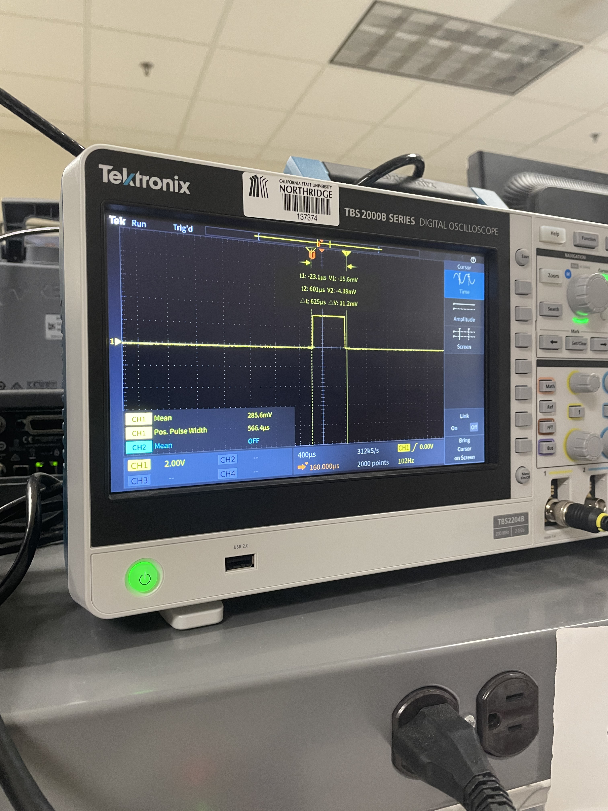

# ECE 528/L - Robotics and Embedded Systems with Lab
**CSU Northridge**

**Department of Electrical and Computer Engineering**

## Motor Control Lab
The Motor Control lab interfaces with the following:

* User LEDs of the TI MSP432 LaunchPad
* Pololu Gearmotor with Encoder - [Product Link](https://www.pololu.com/product/3675)
* Left Bumper Switches for TI-RSLK MAX - [Product Link](https://www.pololu.com/product/3673)
* Right Bumper Switches for TI-RSLK MAX - [Product Link](https://www.pololu.com/product/3674)
* HS-485HB Servo-Stock Rotation - [Product Link](https://www.servocity.com/hs-485hb-servo/)

---

# ECE 528/L - Lab 1: Motor Control

**Author:** Ryan Fuentes

## Overview

This lab covers Pulse Width Modulation (PWM) and edge-triggered interrupts on the MSP432P401R LaunchPad. Timer_A is used to generate PWM signals that drive two HS-485HB servos (Timer_A2) and the two DC motors on the TI-RSLK MAX chassis (Timer_A0). The front bumper switches are set up with falling-edge interrupts on Port 4, and when a collision is detected the robot runs a predefined recovery pattern (stop, back up, turn right, stop). The PWM signals and the bumper switch bouncing were checked on an oscilloscope.

What I implemented:
- `Bumper_Switches_Init` (falling-edge interrupts on P4.7, P4.6, P4.5, P4.3, P4.2, P4.0)
- `Timer_A0_PWM_Init` (PWM on P2.6 and P2.7 for the motors)
- `Motor_Init`, `Motor_Left`, `Motor_Right`
- `Handle_Collision` and the `Bumper_Switches_Handler` update in `main.c`

## Components Used

- MSP432P401R LaunchPad (Texas Instruments)
- USB-A to Micro-USB cable
- TI-RSLK MAX chassis (Pololu) with 6 AA batteries
- 2x bumper switch modules (Pololu)
- 2x HS-485HB servos (ServoCity)
- Breadboard and jumper wires
- Oscilloscope with 2 probes

## Analysis and Results

### Servo PWM (Timer_A2)

PWM signals on P5.6 and P5.7 at a 50 Hz refresh rate, measured on the scope.

| Servo position | Expected pulse width | Measured pulse width |
|---|---|---|
| 0 degrees | 540 - 580 us | 573 us |
| 180 degrees | 2320 - 2360 us | 2.32 ms |

**0 degrees:**

**180 degrees:**

### Bumper switches

Serial terminal output when pressing the bumper switches:

Scope capture of BMP0 (P4.0) and P8.7. There is some bouncing on BMP0 right after the falling edge since the bumper switches have no hardware debounce filter.

## Known Issues or Limitations

- One of the servos we used burned out, so we could not get accurate readings on the oscilloscope.

## References

1. MSP432P401R SimpleLink Microcontroller LaunchPad Development Kit User's Guide
   - [PDF Link](https://docs.rs-online.com/3934/A700000006811369.pdf)

2. MSP432P401R Datasheet
   - [PDF Link](https://www.ti.com/lit/ds/slas826e/slas826e.pdf)

3. Robot Systems Learning Kit (TI-RSLK) User Guide
   - [PDF Link](https://www.ti.com/lit/pdf/sekp166)

4. MSP432P4xx SimpleLink Microcontrollers Technical Reference Manual
   - [PDF Link](https://web.archive.org/web/20200402132841/http:/www.ti.com/lit/ug/slau356i/slau356i.pdf)

5. Left Bumper Switch for TI-RSLK MAX
   - [PDF Link](https://www.pololu.com/product/3673)

6. Right Bumper Switch for TI-RSLK MAX
   - [PDF Link](https://www.pololu.com/product/3674)

7. TI DRV8838 Motor Driver Datasheet
   - [PDF Link](https://www.ti.com/lit/gpn/drv8838)

8. HS-485HB Servo-Stock Rotation Datasheet
   - [PDF Link](https://www.servocity.com/hs-485hb-servo/)
